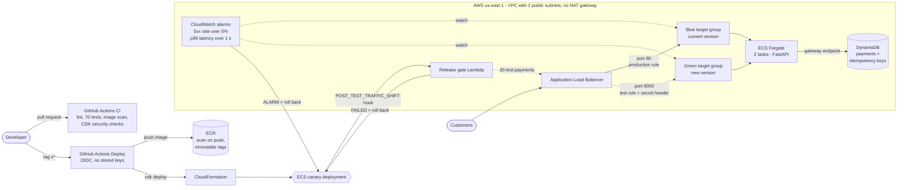
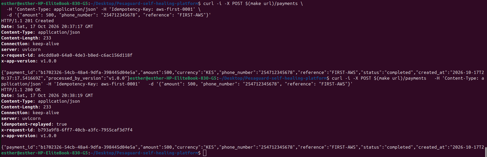

# PesaGuard: Self-Healing Payments Platform

A mobile-money style payments API on AWS that **releases itself safely and rolls back bad releases automatically**, with no human in the loop.

I built the service, its tests, the infrastructure as code, the CI/CD pipelines and the release safety system, then proved it on live AWS: a broken release was **rejected before any customer saw it**, and a slow release was **rolled back by a latency alarm**. The first attempt at that experiment failed, and the investigation is documented here too.


**Stack:** Python 3.12 · FastAPI · Pydantic · DynamoDB · Docker · AWS CDK (Python) · ECS Fargate · Application Load Balancer · AWS Lambda · CloudWatch · SNS · ECR · GitHub Actions (OIDC) · cdk-nag · Trivy · pytest · ruff · k6

---

## Contents

1. [Results](#1-results)
2. [Architecture](#2-architecture)
3. [How a release works](#3-how-a-release-works)
4. [The payments service](#4-the-payments-service)
5. [Testing strategy](#5-testing-strategy)
6. [CI/CD pipelines](#6-cicd-pipelines)
7. [Infrastructure as code](#7-infrastructure-as-code)
8. [Release safety: the gate and the alarms](#8-release-safety-the-gate-and-the-alarms)
9. [Security](#9-security)
10. [Cost control](#10-cost-control)
11. [Architecture decision records](#11-architecture-decision-records)
12. [The release experiments (runbook and results)](#12-the-release-experiments)
13. [Post-incident review: the safety net that was never deployed](#13-post-incident-review-the-safety-net-that-was-never-deployed)
14. [Build journey: problems I hit and how I solved them](#14-build-journey-problems-i-hit-and-how-i-solved-them)
15. [How to run it](#15-how-to-run-it)
16. [Command reference](#16-command-reference)
17. [How this maps to AWS DevOps Professional (DOP-C02)](#17-how-this-maps-to-aws-devops-professional-dop-c02)
18. [Roadmap](#18-roadmap)
19. [Repository layout](#19-repository-layout)

---

## 1. Results

Measured on **19 October 2026** against the live AWS deployment (`us-east-1`), with steady payment traffic running. Times are East Africa Time (UTC+3). Raw output is in [`screenshots/`](screenshots/).

| Release | Fault injected | Stopped by | Detection | Detection → fully rolled back | Customer requests affected |
| --- | --- | --- | --- | --- | --- |
| v1.7.0 | none | promoted | n/a | n/a | 0 |
| v1.8.0-bad | 30% of payments fail | **Release gate** | **1.3 s** (on test traffic) | 80 s | **0** |
| v1.9.1-slow | +1.5 s per payment | **p99 latency alarm** | during the 20% canary | **72 s** | not measured¹ |

ECS's own record (`make deployments`):

| Started | Finished | Status | Reason recorded by ECS |
| --- | --- | --- | --- |
| 23:18:18 | 23:25:08 | **ROLLBACK_SUCCESSFUL** | *Service deployment rolled back because of one or more active alarms.* |
| 23:02:29 | 23:06:01 | **ROLLBACK_SUCCESSFUL** | *Service deployment rolled back because POST_TEST_TRAFFIC_SHIFT lifecycle hook(s) failed. Lifecycle hook target …ReleaseGateFunction… returned FAILED status.* |
| 22:49:52 | 22:58:13 | SUCCESSFUL | v1.7.0, promoted |
| 22:29:30 | 22:38:00 | SUCCESSFUL | v1.4.0, first deploy of the fixed stack |

What the release gate logged for the broken release (`make gate-logs`):

```json
{"msg": "gate result", "passed": false, "ok": 12, "checks": 20,
 "failures": ["payment 0: expected 201, got 500", "payment 3: expected 201, got 500",
              "payment 4: read-back failed with 500", "payment 7: expected 201, got 500",
              "payment 11: read-back failed with 500", "payment 13: expected 201, got 500",
              "payment 15: expected 201, got 500", "payment 16: read-back failed with 500"],
 "versions_seen": ["v1.8.0-bad"], "p50_ms": 26.5, "max_ms": 188.3}
```

The same gate passed the good releases: **20/20 checks, p50 25 ms** for both v1.4.0 and v1.7.0.

Alarm history for the slow release (`make alarm-history`):

```
2026-10-19T23:23:56  pesaguard-blue-latency-p99  Alarm updated from OK to ALARM
```

¹ During the 20% canary, up to a fifth of requests reached the slow version before the alarm fired. The exact count comes from the release watcher CSV in `screenshots/`.

<!-- Add these files to screenshots/ and they will show here -->


---

## 2. Architecture



**Request path:** internet → ALB (port 80) → production listener rule → the live target group → Fargate task → DynamoDB (via a free VPC gateway endpoint).

**Release path:** tag → GitHub Actions (OIDC) → image to ECR → `cdk deploy` → CloudFormation → ECS canary deployment, guarded by the release gate and the alarms.

### AWS resources (5 CDK stacks)

| Stack | What it creates |
| --- | --- |
| PesaGuardNetwork | VPC `10.20.0.0/16`, 2 public subnets in 2 availability zones, **no NAT gateway**, free DynamoDB gateway endpoint |
| PesaGuardData | DynamoDB table `pesaguard-payments`, on-demand billing, point-in-time recovery |
| PesaGuardEcr | Image registry `pesaguard`, scan on push, **immutable tags**, keeps the 15 most recent images |
| PesaGuardGithubOidc | GitHub OIDC provider and deploy role, trusted only for `main` and `v*` tags of this repo |
| PesaGuardService | ALB (production listener on 80, test listener on 9000), blue and green target groups, ECS cluster and Fargate service (2 tasks), canary deployment, release gate Lambda, 4 rollback alarms, SNS alarm topic, log groups |

---

## 3. How a release works

1. **Green starts.** ECS starts the new version in the idle target group. Customers still use blue.
2. **Release gate (correctness).** The test listener points at green, and ECS calls the release gate Lambda at the `POST_TEST_TRAFFIC_SHIFT` lifecycle stage. It sends 20 real payments, reads each one back, and checks that a retry is never charged twice. **Any failure means ECS rolls back.** No customer has touched the new version yet.
3. **Canary.** 20% of real traffic moves to green for 2 minutes.
4. **Full shift and bake.** 100% moves to green. Blue stays running for 3 more minutes, so a rollback is instant.
5. **Alarms (performance).** During steps 3 and 4, a 5xx rate above 5% or p99 latency above 1 s on either target group **rolls the release back**.
6. **Circuit breaker.** If the new tasks fail to start at all, ECS's deployment circuit breaker rolls back.

A plain health check catches neither bad release: both returned `200` from `/health`. That's the core idea of the project. Rollback must depend on what customers actually experience.

---

## 4. The payments service

Code: [`app/pesaguard/`](app/pesaguard/)

### Endpoints

| Method | Path | Purpose |
| --- | --- | --- |
| POST | `/payments` | Create a payment. Header `Idempotency-Key` (8–128 chars) is required. Returns `201`, or `200` with `Idempotent-Replayed: true` for a retry. |
| GET | `/payments/{id}` | Fetch a payment |
| GET | `/health` | Liveness: the process is up (never touches the database) |
| GET | `/ready` | Readiness: the database is reachable (`503` if not) |
| GET | `/docs` | Interactive API docs |

Every response carries `x-request-id` and `x-app-version` headers, so you can always tell which release answered a request.

### Idempotency: never charge a customer twice

If a client sends the same request twice with the same `Idempotency-Key` (for example because the network dropped the first response), the customer is charged once and both calls get the same answer.

- Each request body is fingerprinted with SHA-256.
- Two DynamoDB items are written **in one transaction**, each with `attribute_not_exists(pk)`:
  - `pk = "IDEM#<key>"`: the idempotency record (fingerprint and payment ID)
  - `pk = "PAY#<payment_id>"`: the payment itself
- If the transaction is cancelled because the key exists, the service reads the original:
  - **same fingerprint:** returns the original payment with `200` and `Idempotent-Replayed: true`
  - **different body with the same key:** returns `409 Conflict`

Because the check happens inside DynamoDB, two identical requests arriving at the same millisecond on two different containers still cannot create two payments. A test sends 10 identical requests concurrently and asserts exactly one payment exists.



### Validation rules

| Field | Rule | Why |
| --- | --- | --- |
| `amount` | integer, greater than 0, at most 150,000 | Whole shillings as integers avoid floating-point rounding errors with money |
| `currency` | `KES` only | Kenyan mobile money |
| `phone_number` | `^254(7\|1)\d{8}$` | Kenyan mobile numbers in international format |
| `reference` | 1–64 characters | Merchant's own reference |

### Fault modes (for testing rollback)

`FAULT_MODE` is baked into the image at build time:

| Value | Effect |
| --- | --- |
| `none` | normal behaviour (default) |
| `error_rate=0.3` | 30% of payment requests fail with `500` |
| `latency_ms=1500` | every payment request is delayed by 1.5 s |

Two deliberate choices:
- **Faults only affect `/payments`, never `/health`.** Real bad releases usually still pass a basic health check, which is exactly why the safety system watches business behaviour.
- **An invalid `FAULT_MODE` stops the container at startup**, so a typo fails loudly instead of shipping silently without the fault.

### Logging

One JSON object per line (timestamp, level, request ID, method, path, status, duration, version, colour), so CloudWatch Logs Insights can filter and count by any field, for example every failed payment handled by v1.8.0-bad.

### Container

- Multi-stage Dockerfile on `python:3.12-slim`
- Runs as an unprivileged user (UID 10001), never root
- Read-only root filesystem on ECS
- Built-in `HEALTHCHECK` against `/health`
- Local development: `docker-compose.yml` runs the API with **DynamoDB Local**, so no AWS account is needed

---

## 5. Testing strategy

**70 automated tests** run on every pull request.

| Suite | Tests | What it proves |
| --- | --- | --- |
| App ([`app/tests/`](app/tests/)) | 40 | Payments, validation, idempotency (including 10 concurrent duplicates), fault modes, liveness vs readiness, database outage returns 503. **95% coverage**; CI fails below 80%. |
| DynamoDB logic | (in app suite) | The real transaction code runs against **moto**, a local fake of AWS, so the conditional writes are tested without an account |
| Release gate ([`release_gate/tests/`](release_gate/tests/)) | 7 | Passes a healthy release; fails one with errors, broken idempotency, or an unreachable service; a real-socket test of the HTTP layer. **100% coverage.** |
| Release watcher ([`scripts/`](scripts/)) | 3 | Per-version first/last seen and failure counts |
| Infrastructure ([`infra/tests/`](infra/tests/)) | 20 | Asserts the security and cost decisions are really in the generated CloudFormation: no NAT gateway, immutable tags, OIDC trust limited to `main`/`v*`, canary strategy, 4 alarms with the right thresholds, gate hook at `POST_TEST_TRAFFIC_SHIFT`, only ports 80 and 9000 public, read-only container, 7-day log retention |

The infrastructure tests are what caught the incident in section 13. When run against the old service stack, 6 of the 20 failed, exactly on the missing canary, alarms, gate and test listener.

---

## 6. CI/CD pipelines

### CI ([`.github/workflows/ci.yml`](.github/workflows/ci.yml)), on every pull request and push to `main`

| Job | Steps |
| --- | --- |
| **Lint and test** | ruff lint and format check, app tests (80% coverage gate), release gate tests, watcher tests |
| **Infrastructure tests and security checks** | ruff, 20 CDK tests, `cdk synth`, which **fails on any unacknowledged cdk-nag finding** |
| **Build, scan and smoke test** | Docker build, **Trivy** scan (fails on fixable HIGH/CRITICAL vulnerabilities), docker-compose smoke test that makes a real payment |

**Decision:** Trivy is pinned to `trivy-action@v0.35.0`. Most older tags of that action were hijacked in March 2026 (CVE-2026-33634) and replaced with credential-stealing code. Pinning to a known-safe version, ideally a full commit SHA, is the fix.

### Deploy ([`.github/workflows/deploy.yml`](.github/workflows/deploy.yml))

- Triggered by pushing a `v*` tag, or by hand with a choice of fault mode (`none`, `error_rate=0.3`, `latency_ms=1500`)
- Signs in to AWS with **OIDC**: no AWS keys are stored in GitHub. The role ARN is a repository variable (`AWS_DEPLOY_ROLE_ARN`).
- Builds and pushes the image (reuses it if the tag already exists, because tags are immutable)
- Runs `cdk deploy`. CloudFormation waits for the ECS deployment, so if the gate or an alarm rolls the release back, **the job goes red**. The pipeline tells the truth.
- `concurrency: deploy-production` stops two releases running at once

### Other repository settings

- **Dependabot** checks pip, Docker and GitHub Actions dependencies weekly
- **Pull request template** asks for what changed, why, how it was tested, and the risk and rollback plan
- **Branch protection** on `main`: pull requests required, all three CI jobs must pass

---

## 7. Infrastructure as code

All infrastructure is AWS CDK in Python ([`infra/`](infra/)), so everything can be rebuilt from nothing and torn down completely.

Key settings and why:

| Setting | Value | Why |
| --- | --- | --- |
| Region | `us-east-1` | Usually the cheapest, and every service is available |
| Fargate task size | 0.25 vCPU, 512 MB | Smallest size; enough for this service |
| Tasks | 2, one per availability zone | Survives one zone failing |
| Target group health check | `/ready` every 10 s | Only send traffic to tasks that can reach the database |
| Container health check | `/health` | ECS replaces a hung process |
| Deployment | `CANARY`, 20% for 2 min, then 3 min bake | Real traffic tests the release before everyone gets it |
| Circuit breaker | on, with rollback | Tasks that won't start are rolled back |
| Log retention | 7 days | Enough to investigate; limits cost |
| DynamoDB removal policy | delete on destroy (`-c retainData=true` keeps it) | A learning project should leave nothing behind |
| ECR images kept | 15 most recent | Limits storage cost |

**Load balancer detail:** ECS native blue/green needs **both target groups in the production listener rule**, with weights 100/0. ECS flips the weights to move traffic and flips them back to roll back. The test listener rule works the same way. I learned this from the AWS troubleshooting guide after my first design forwarded to one target group only.

**Security checks:** every synth runs **cdk-nag** (AWS Solutions rules). Each finding I accepted is acknowledged in code with a written reason:

| Finding | Reason accepted |
| --- | --- |
| VPC flow logs off | They cost per GB; enable for investigations or production |
| ALB access logs off | Need an S3 bucket and cost money; the app already logs every request |
| Ports 80 and 9000 open to the internet | Public HTTP API; port 9000 only forwards requests with the test header. HTTPS needs a domain (roadmap). |
| Container Insights off | Extra cost; considered in Phase 4 |
| Environment variables on the task | Plain configuration only (version, table, region); no secrets |
| `ecr:GetAuthorizationToken` on `*` | AWS only supports `*` for this action |
| Wildcard on CDK bootstrap roles | Limited to this account's `cdk-hnb659fds-*` roles |
| AWS-managed policies | Lambda basic logging, and the ECS policy needed to switch load balancer weights |

---

## 8. Release safety: the gate and the alarms

### Release gate

Code: [`release_gate/handler.py`](release_gate/handler.py) (Python 3.14 Lambda)

For each of 20 checks, it:
1. `POST /payments` with a unique idempotency key, expects `201`
2. `GET /payments/{id}`, expects the same payment back
3. On the first check, repeats the POST with the same key, expects `200` and the **same** payment ID (proves idempotency still works)

Requests go through the **test listener on port 9000** with a secret header, so they reach the new version only. It returns `{"hookStatus": "SUCCEEDED"}` or `{"hookStatus": "FAILED"}` to ECS and logs a JSON summary (passes, failures, versions seen, p50 and max latency).

**Decision:** the gate allows a generous 5 s per request. It checks that payments **work**, not how fast. Speed is judged by the alarms against real traffic. That keeps the two layers from overlapping and makes each easy to explain.

### Rollback alarms

Code: [`infra/stacks/release_safety.py`](infra/stacks/release_safety.py)

| Alarm | Metric | Threshold | Period |
| --- | --- | --- | --- |
| `pesaguard-blue-error-rate` / `green-error-rate` | 100 × target 5xx ÷ requests (ignored below 5 requests per minute) | > 5% | 1 minute |
| `pesaguard-blue-latency-p99` / `green-latency-p99` | ALB `TargetResponseTime`, p99 | > 1 s | 1 minute |

- **Both target groups get alarms**, because they swap roles every release. This release's green is the next release's blue.
- Missing data counts as **not breaching**, so an idle service doesn't trigger rollbacks.
- All four are attached to the ECS service with `ROLLBACK_ON_ALARM`, and they notify an SNS topic.

### Release watcher

Code: [`scripts/watch_release.py`](scripts/watch_release.py), standard library only.

Sends one real payment per second to the public URL during a release and records the time, status, latency and **which version answered** to a CSV in `evidence/`. Ctrl+C prints a summary per version (first seen, last seen, requests, failures). It also provides the steady traffic the alarms need.

---

## 9. Security

- **No long-lived AWS keys in GitHub.** GitHub Actions gets short-lived credentials through OIDC. The trust policy allows only pushes to `main` and `v*` tags of this one repository; **pull requests can never deploy**. An infrastructure test asserts this.
- **Least privilege for the deploy role.** It can push to one ECR repository, read one stack's outputs, and assume the CDK bootstrap roles. Nothing else.
- **Network:** tasks accept traffic only from the load balancer's security group, on port 8000. The load balancer accepts only ports 80 and 9000. DynamoDB traffic stays on the AWS network.
- **Containers:** non-root user, read-only root filesystem, images scanned in CI (Trivy) and on push (ECR).
- **Immutable image tags:** `v1.8.0` always means the same image, which matters when working out which release caused a problem.
- **Supply chain:** Trivy action pinned after CVE-2026-33634; Dependabot for updates.
- **Personal AWS access:** a dedicated IAM user, not the root account; MFA on root; keys never committed or shared.
- **Account ID** blurred or replaced in public screenshots.

---

## 10. Cost control

| Decision | Saving |
| --- | --- |
| **No NAT gateway** | A NAT gateway bills by the hour even when idle; it would have cost more than everything else combined |
| DynamoDB on-demand | Nothing to pay when idle |
| Smallest Fargate size | 0.25 vCPU / 512 MB |
| 7-day log retention, 15 images kept | Limits storage |
| `make stop` after every session | Deletes the load balancer and tasks, the parts billed by the hour; rebuild with one command |
| `make destroy-all` | Removes everything when pausing the project |
| **$10 AWS Budget alert** | Set up before deploying anything |

Because everything is code, tearing down and rebuilding is safe and fast. I deleted the whole environment (including the CDK bootstrap stack and its S3 bucket) and rebuilt it from scratch during the project.

---

## 11. Architecture decision records

### ADR 0001: Run on ECS Fargate, not EKS

**Context.** One small stateless API that needs zero-downtime releases, automatic rollback and fault injection, on a learning budget.

**Decision.** Amazon ECS with the Fargate launch type.

**Why.**
- No cluster to pay for or patch. EKS charges for the control plane before any workload runs.
- Blue/green, canary and linear strategies are built into ECS, with bake time and alarm-based rollback. No extra controller (such as Argo Rollouts) is needed.
- AWS Fault Injection Service has ECS task actions that work on Fargate (for Phase 6).
- ECS deployments feature heavily in the DOP-C02 exam.

**Trade-offs.** Less portable than Kubernetes, and Kubernetes skills are widely requested. Mitigation: a roadmap item ports the service to Kubernetes with Argo Rollouts and compares the two.

### ADR 0002: Use ECS native deployments, not CodeDeploy

**Context.** Releases must never take the service down, and bad releases must roll back without a human. AWS offers ECS deployments driven by CodeDeploy, or ECS's own built-in blue/green (launched July 2025), with canary and linear added later.

**Decision.** ECS native deployments: started with `BLUE_GREEN`, moved to `CANARY` for the release safety work.

**Why.**
- Fewer moving parts: no CodeDeploy application, deployment group or AppSpec file.
- Rollback triggers (circuit breaker, CloudWatch alarms) are configured on the service itself.
- Lifecycle hooks can call a Lambda at specific stages, which is where the release gate runs.

**How it works here.** Two target groups. The production rule forwards to both with weights 100/0; ECS flips them to move traffic and flips them back to roll back. A 3-minute bake keeps the old version running after the switch.

**Trade-offs.** The exam still asks about CodeDeploy deployment configurations, so I study those separately. After a release the live weights differ from the template, which is expected; CloudFormation leaves the rule alone unless its definition changes.

### ADR 0003: Public subnets without a NAT gateway

**Context.** The usual pattern puts tasks in private subnets and sends their outbound traffic (pulling images, reaching AWS APIs) through a NAT gateway, which is billed by the hour plus data charges, even when idle.

**Decision.** Tasks run in public subnets with public IPs and no NAT gateway, plus a free DynamoDB gateway endpoint.

**How the tasks stay protected.** The task security group allows inbound traffic **only from the load balancer's security group**, on port 8000, so nothing on the internet can connect to a task directly despite its public IP. DynamoDB traffic never leaves the AWS network.

**Trade-offs.** Defence in depth is weaker: a security group mistake would expose tasks directly. That's why an infrastructure test asserts only ports 80 and 9000 are open to the internet. For production: private subnets with VPC interface endpoints (ECR, CloudWatch Logs) or a NAT gateway, and HTTPS with a domain certificate.

### ADR 0004: Two layers of release safety (gate + alarms)

**Context.** A health check alone misses most bad releases. A release that fails 30% of payments, or answers every payment in 1.5 seconds, still returns `200` from `/health`. Rollback must depend on what customers experience.

**Decision.** Two independent layers, each catching a different kind of failure.

| Layer | When | Checks | Catches |
| --- | --- | --- | --- |
| Release gate (Lambda lifecycle hook) | After green gets **test** traffic, before any customer | 20 real payments, read-backs, an idempotency retry | Broken releases: errors, wrong responses, double charging |
| CloudWatch alarms | During the 20% canary and the 3-minute bake | 5xx rate > 5%, p99 latency > 1 s, per target group | Releases that work but are slow, or fail only under real traffic |

**Proven.** v1.8.0-bad was stopped by the gate in 1.3 s with no customer impact; v1.9.1-slow was stopped by the latency alarm (section 1).

**Trade-offs.**
- **Alarms need traffic.** With no requests there's no data, and the alarm stays OK. The experiments used the watcher for steady traffic; production would rely on real users or a synthetic canary.
- **Detection delay.** Load balancer metrics reached CloudWatch about 2.5 minutes after the events, so the alarm layer is slower than the gate.
- **The test listener is reachable from the internet.** The gate Lambda runs outside the VPC (there's no NAT gateway), so port 9000 is open, but it only forwards requests carrying the test header and only the not-yet-live version sits behind it. The header value isn't a strong secret. A production setup would run the gate inside the VPC against an internal listener.
- **Test traffic counts toward the same alarms.** The gate's own 500 errors briefly tripped an error-rate alarm after the v1.8.0-bad rollback. That was harmless, but production should separate test and production metrics.
- **Synthetic payments are written to the real table** with reference `RELEASE-GATE-*`, so they can be filtered out of reports.

---

## 12. The release experiments

### Runbook

1. Deploy a known-good version: `make deploy-service TAG=v1.4.0`.
2. **Verify the safety net exists** (added after the incident in section 13):
   ```bash
   make alarms        # must list 4 pesaguard- alarms
   aws lambda list-functions --query "Functions[?contains(FunctionName,'ReleaseGate')].FunctionName"
   ```
3. In a second terminal, start the watcher and leave it running: `make watch`.
4. Run three releases, one at a time, each with a **new** tag (tags are immutable):

   | Release | Command | Expected |
   | --- | --- | --- |
   | Good | `make release TAG=v1.7.0` | promoted; command succeeds |
   | Broken | `make release TAG=v1.8.0-bad FAULT_MODE=error_rate=0.3` | stopped by the gate; command **ends in an error** (correct) |
   | Slow | `make release TAG=v1.9.1-slow FAULT_MODE=latency_ms=1500` | gate passes, latency alarm rolls back; command **ends in an error** (correct) |

5. Collect evidence: `make deployments`, `make alarm-history`, `make gate-logs`, and Ctrl+C on the watcher for its summary.
6. Save the outputs to `evidence/`, take screenshots, then `make stop`.

### Timeline of the successful run (19 Oct 2026, EAT)

| Time | Event |
| --- | --- |
| 22:29–22:38 | Fixed stack deployed with v1.4.0; gate passes 20/20; 4 alarms created |
| 22:49–22:58 | **v1.7.0** released; gate passes 20/20 (p50 25 ms); promoted |
| 23:02:29 | **v1.8.0-bad** release starts |
| 23:04:39.4 | Gate starts testing the new version on the test listener |
| 23:04:40.8 | Gate returns **FAILED** (12/20 passed, 8 failures) |
| 23:06:01 | **ROLLBACK_SUCCESSFUL**; the bad version only ever received gate traffic |
| 23:07:17–23:08:17 | Error-rate alarm briefly in ALARM, from the gate's own 500s (metric delay ~2.5 min) |
| 23:18:18 | **v1.9.1-slow** release starts; gate passes (payments work, just slowly) |
| ~23:21 | Canary sends 20% of real traffic to the slow version |
| 23:23:56 | `pesaguard-blue-latency-p99` → **ALARM** |
| 23:25:08 | **ROLLBACK_SUCCESSFUL**, 72 s after detection |

(The target group names "blue" and "green" are fixed, but the groups swap roles each release, so the slow version happened to be in the "blue" group.)

---

## 13. Post-incident review: the safety net that was never deployed

### Summary

During the first run of the release experiments, **two deliberately bad releases reached customers**. A release failing 30% of payments and a release adding 1.5 s to every payment were both deployed as SUCCESSFUL, and the slow version served real payments in 2.75 s. The release gate and rollback alarms existed in the repository but had never been deployed. No real customers were involved (this is a test environment), but in production this would have been an outage.

### Timeline (19 Oct 2026, EAT)

| Time | Event |
| --- | --- |
| 21:01–21:03 | v1.0.0 deployed |
| 21:05–21:11 | v1.4.0 released: SUCCESSFUL |
| 21:14–21:20 | **v1.5.0-bad (30% errors) released: SUCCESSFUL.** Expected: stopped by the gate. |
| 21:23–21:29 | **v1.6.0-slow (+1.5 s) released: SUCCESSFUL.** Expected: rolled back by the latency alarm. |
| ~21:32 | Detected: the stack output reported `ImageTag = v1.6.0-slow`, and a test payment took **2.75 s** |
| 21:40–21:46 | Mitigated: rolled forward to the known-good v1.4.0 |
| ~21:50 | Diagnosed: no release gate Lambda, no `/pesaguard/release-gate` log group, no `pesaguard-` alarms, no `AlarmTopicArn` stack output |
| ~21:55 | Root cause found: `service_stack.py` had 0 references to `CANARY` or `ReleaseGate` |
| ~22:00 | Confirmed: running the updated tests gave **6 failed, 14 passed**, exactly on the missing features |
| 22:06 | Fix applied locally: 20/20 tests, lint and synth pass |
| 22:29–22:38 | Fixed stack deployed; 4 alarms and the gate Lambda verified in AWS |
| 22:49–23:25 | Experiment rerun: **both bad releases rolled back automatically** (section 1) |

### Root cause

`release_safety.py` (the gate and alarms) was committed, but **`service_stack.py` was still the previous version**, so nothing used the new code. The deployed service was plain blue/green with no lifecycle hook and no deployment alarms.

### Why it wasn't caught (5 whys)

1. **Why did bad releases reach customers?** The deployed service had no gate and no alarms.
2. **Why?** The service stack that wires them in was never updated.
3. **Why did CI pass?** CI ran the **old** infrastructure tests. The updated `test_stacks.py`, which checks for the canary, alarms and gate, existed on my laptop but had not been committed.
4. **Why weren't the files committed?** Files were added by pasting code into the terminal across several sessions, and some commits landed on the wrong branch. I never compared what was committed with what was meant to be there.
5. **Why didn't the deployment itself reveal it?** Nothing checked, after deploying, that the safety components actually existed in AWS. "Deployed successfully" was treated as "working".

### Contributing factors

- Large changes copied into the terminal by hand, file by file
- Commits made on the wrong branch, then moved
- A green CI badge trusted without checking which tests it ran
- The release experiment started without verifying its own preconditions

### What went well

- The **release watcher and stack outputs exposed the problem quickly**: a 2.75 s payment and an unexpected `ImageTag`.
- **Evidence before action:** I collected the deployment list, Lambda list, log groups and alarm states before changing anything, which led directly to the root cause.
- **Rollback was easy:** a single `make deploy-service TAG=v1.4.0` restored the good version.
- **The tests were right:** once committed, they failed on exactly the missing features.

### Action items

| # | Action | Status |
| --- | --- | --- |
| 1 | Wire the gate and alarms into `service_stack.py` | Done |
| 2 | Commit the missing infrastructure and release gate tests | Done (CI now runs all 70) |
| 3 | Verify the safety net exists before any release experiment (`make alarms` lists 4; gate Lambda exists) | Done (runbook step 2) |
| 4 | Run `git status --short` before every commit; nothing untracked that belongs in the repo | Adopted |
| 5 | Add an automated post-deploy check to the deploy pipeline that fails if the alarms or gate are missing | Planned |
| 6 | Prefer complete files or archives over pasted fragments for multi-file changes | Adopted |

### Lessons

- **"It deployed successfully" is not evidence that it works.** Verify the thing you depend on actually exists.
- **A green CI badge only means the committed tests passed.** If the important tests aren't committed, CI proves nothing about them.
- **Run the experiment.** Without the experiment, this gap would have stayed hidden. Testing the safety net is part of building it.

---

## 14. Build journey: problems I hit and how I solved them

| Phase | Problem | Cause | Fix |
| --- | --- | --- | --- |
| Setup | `git push` rejected my password | GitHub no longer accepts passwords for Git | Created an SSH key, added it to GitHub, switched the remote to SSH |
| 1 | `make: No rule to make target 'install'` | Makefile missing or named wrongly | Recreated it in the project's top folder |
| 1 | `ImportError: cannot import name 'Settings'` | Code pasted into the wrong files (`conftest.py` in `pesaguard/`, config code in `__init__.py`) | Moved files to the right folders, recreated `tests/__init__.py` |
| 1 | `ruff format --check` failed on 12 files | Pasted files had no final newline | `make format`; turned on "insert final newline" in the editor |
| 1 | `docker compose`: no configuration file found | File saved as `Docker-compose.yaml` | Recreated `docker-compose.yml` |
| 1 | `.dockerignore` had no effect | Saved in the top folder, but the build context is `app/` | Moved it to `app/.dockerignore` |
| 2 | CI step "Lint and test" failed | Formatting | Fixed locally, then pushed |
| 3 | `.venv/bin/pytest: not found` | Infra virtualenv not created | `make infra-install` |
| 3 | `make` failed inside `infra/` | No Makefile there | Always run `make` from the top folder |
| 3 | Node.js 18 end-of-life | Ubuntu package was old | Installed Node 22 LTS with nvm, reinstalled the CDK CLI |
| 3 | AWS CLI installer files showed up in `git status` | Downloaded into the project folder | Deleted them; download installers to `~/Downloads` |
| 3 | Commit landed on `main` instead of a feature branch | `git checkout -b` skipped | Created the branch at that commit and reset `main` to `origin/main` |
| 3 | First ECS blue/green design invalid | ECS needs both target groups in the production rule, weighted 100/0 | Weighted forward to both groups (from the AWS troubleshooting guide) |
| 3 | `cdk-nag` import error | cdk-nag 3 replaced `NagSuppressions` with CDK's `Validations` API | Wrote a small `acknowledge()` helper using the new API |
| 5 | Phase 5 commit pushed to the Phase 3 branch | Branch not switched | Shipped Phase 3 and 5 as one pull request |
| 5 | `make release` push rejected | Tag `v1.9.0-slow` already existed, and tags are immutable | Used a new tag, `v1.9.1-slow` |
| 5 | **Bad releases reached customers** | Safety net never deployed | See the post-incident review (section 13) |
| 5 | CI "no tests ran" for the release gate | `test_handler.py` never created or committed | Recreated and committed it; 7 tests, 100% coverage |
| Ops | Resources still visible after `make stop` | `make stop` keeps the cheap base stacks on purpose | `make destroy-all`, then deleted the CDK bootstrap stack and its S3 bucket |

---

## 15. How to run it

### Locally (no AWS account needed)

Requires Docker and Python 3.12+.

```bash
make install && make test   # app, release gate and watcher tests
make up                     # API + DynamoDB Local on http://localhost:8080

curl -i -X POST http://localhost:8080/payments \
  -H 'Content-Type: application/json' \
  -H 'Idempotency-Key: order-1001-attempt' \
  -d '{"amount": 1500, "phone_number": "254712345678", "reference": "ORDER-1001"}'
# Run it again: 200, Idempotent-Replayed: true, same payment_id

make bad-release-errors     # 30% of payments fail, /health still says OK
make down
```

### On AWS

Requires the AWS CLI (configured with an IAM user, not root), Node.js 22+, and the CDK CLI (`npm i -g aws-cdk`).

```bash
# One-time per account and region
cdk bootstrap aws://<account-id>/us-east-1

make infra-install && make infra-test   # CDK libraries + 20 infrastructure tests
make deploy-base                         # network, table, registry, GitHub deploy role
make push TAG=v1.0.0
make deploy-service TAG=v1.0.0           # service, gate, alarms
make alarms                              # verify: 4 alarms must exist
curl $(make url)/health
```

To let GitHub Actions deploy, save the `DeployRoleArn` output from `make deploy-base` as a repository variable named `AWS_DEPLOY_ROLE_ARN` (Settings → Secrets and variables → Actions → Variables).

### Tear down

```bash
make stop          # end of session: removes the load balancer and tasks
make destroy-all   # removes everything (table, images, role, network)
```

---

## 16. Command reference

| Command | What it does |
| --- | --- |
| `make install` / `make test` | Create the virtualenv / run app, gate and watcher tests |
| `make lint` / `make format` | Check / fix code style in all Python folders |
| `make up` / `make down` | Start / stop the API with DynamoDB Local |
| `make bad-release-errors` / `make bad-release-slow` | Run a deliberately bad release locally |
| `make load` | k6 load test (`BASE_URL=...` for AWS) |
| `make infra-install` / `make infra-test` | CDK virtualenv / 20 infrastructure tests |
| `make synth` | Generate CloudFormation and run cdk-nag, without touching AWS |
| `make deploy-base` | Deploy network, table, registry, GitHub role |
| `make push TAG=…` | Build and push an image (`FAULT_MODE=…` for a bad one) |
| `make deploy-service TAG=…` | Deploy or update the service |
| `make release TAG=… [FAULT_MODE=…]` | Push and canary-release in one step |
| `make watch` | Watch a release from the customer's side; saves a CSV |
| `make alarms` / `make alarm-history` | Alarm states / when each fired |
| `make deployments` | ECS's record of recent releases and rollback reasons |
| `make gate-logs` | What the release gate saw |
| `make url` / `make status` | Public address / running tasks and deployment state |
| `make stop` / `make destroy-all` | Remove hourly-billed parts / everything |

---


## 18. Roadmap

- [x] Phase 1: payments service, idempotency, fault modes, tests
- [x] Phase 2: CI with lint, tests, vulnerability scan, smoke test
- [x] Phase 3: AWS infrastructure as code (CDK, ECS Fargate, ALB, OIDC)
- [ ] Phase 4: observability and SLOs: rollback alarms done; CloudWatch dashboard and SLO document next
- [x] Phase 5: self-healing releases (canary, release gate, automatic rollback), **proven on AWS**
- [ ] Phase 6: game day with AWS Fault Injection Service (task crashes, network latency, packet loss, CPU stress)
- [ ] Automated post-deploy check in the pipeline (incident action item 5)
- [ ] HTTPS with a domain and ACM certificate
- [ ] Release gate inside the VPC against an internal test listener
- [ ] Kubernetes version with Argo Rollouts, compared with ECS

---

## 19. Repository layout

```
app/                FastAPI payments service
  pesaguard/          config, models, faults, logging, repository (DynamoDB), main
  tests/              40 tests, including DynamoDB logic against moto
  Dockerfile          multi-stage, non-root
release_gate/       Lambda that tests each release before customers see it
  handler.py
  tests/              7 tests, 100% coverage
infra/              AWS CDK app
  app.py              wires the 5 stacks together, enables cdk-nag
  stacks/             network, data, ecr, github_oidc, service, release_safety, nag helper
  tests/              20 infrastructure tests
scripts/            release watcher + tests
load/               k6 load test
evidence/           raw output from the release experiments
screenshots/        images used in this README
.github/
  workflows/          ci.yml, deploy.yml
  dependabot.yml
  pull_request_template.md
docker-compose.yml  local API + DynamoDB Local
Makefile            every command in section 16
```